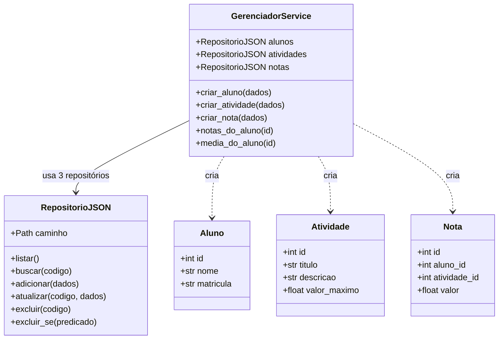
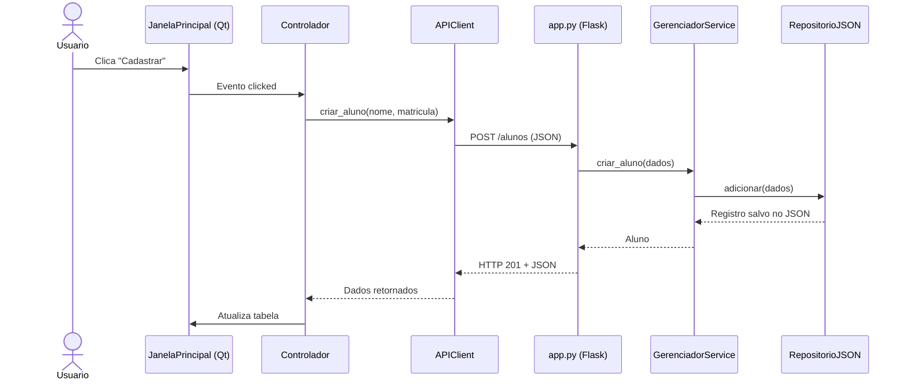

# Diagramas de classes — estrutura implementada

Os diagramas usam a sintaxe **Mermaid** e aparecem automaticamente no GitHub.

## Servidor

`create_app()` em `app.py` é uma **função-fábrica Flask**, não uma classe. As rotas chamam `GerenciadorService`; este utiliza `RepositorioJSON` para persistência.

## Cliente

```mermaid
classDiagram
  class JanelaPrincipal {
    +QMainWindow
    +preencher_tabela(tabela, linhas)
    +preencher_combo(combo, opcoes, chave)
  }
  class Controlador {
    +JanelaPrincipal janela
    +APIClient api
    +criar_aluno()
    +editar_aluno()
    +criar_atividade()
    +criar_nota()
    +consultar()
    +atualizar_listagens()
  }
  class APIClient {
    +str endereco
    +listar_alunos()
    +criar_aluno(nome, matricula)
    +listar_atividades()
    +criar_nota(aluno_id, atividade_id, valor)
    +media_do_aluno(aluno_id)
    -_requisitar(metodo, caminho, dados)
  }
  Controlador --> JanelaPrincipal : lê eventos e atualiza
  Controlador --> APIClient : utiliza Facade
```

## Fluxo da requisição

