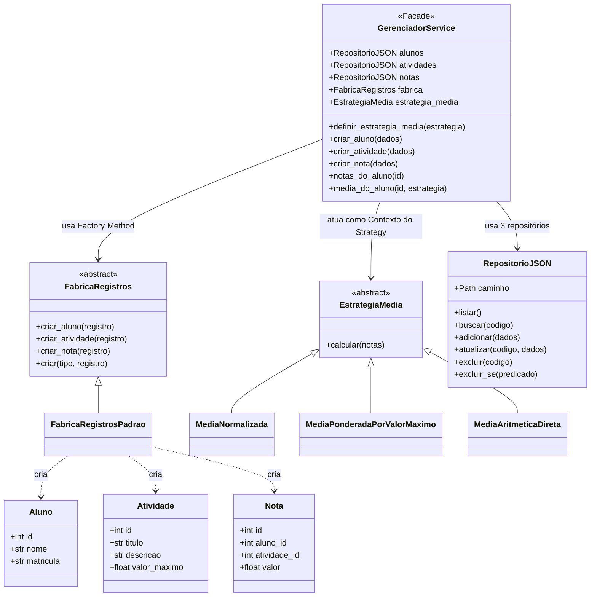
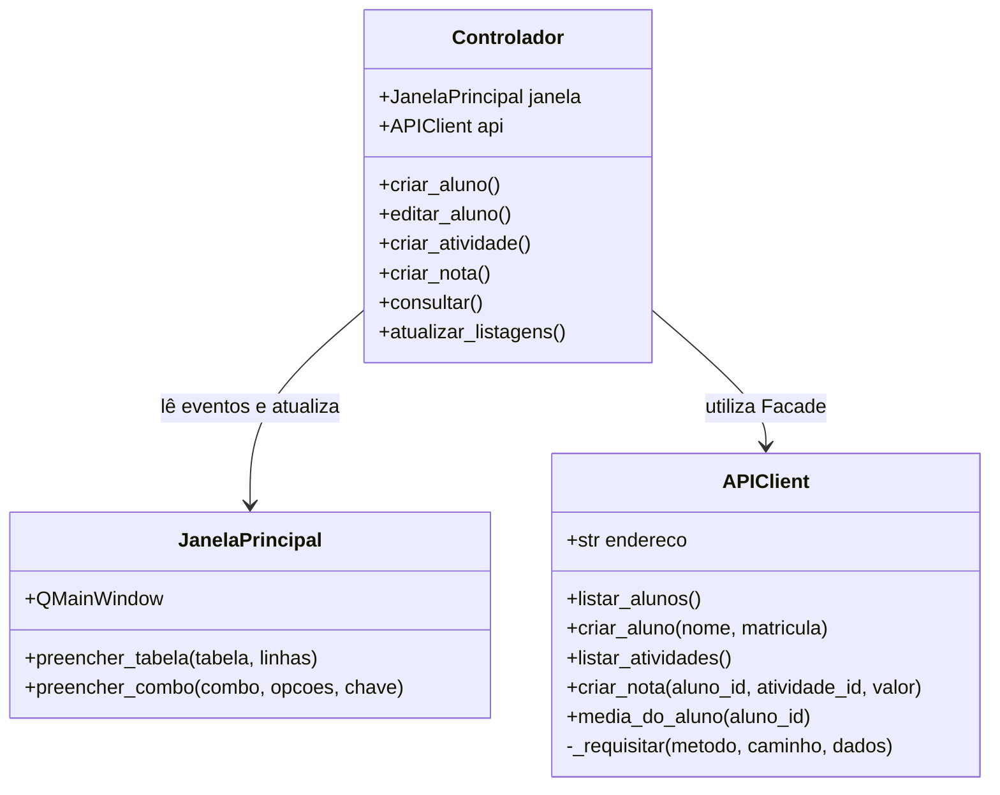
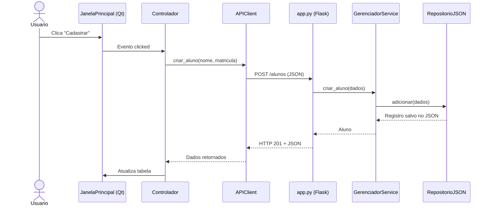

# Diagramas de classes — estrutura implementada

Os diagramas usam a sintaxe **Mermaid** e aparecem automaticamente no GitHub. Mermaid é uma boa escolha para este projeto porque o diagrama fica versionado como texto junto ao código, pode ser revisado por diff e é renderizado pelo GitHub. A documentação oficial suporta classes, interfaces, herança, dependências e cardinalidades.

Para visualizar ou editar fora do GitHub, use o [Mermaid Live Editor](https://mermaid.live/). Não é necessário instalar uma biblioteca no projeto: os blocos Mermaid já são suficientes para a documentação.

## Servidor

`create_app()` em `app.py` é uma **função-fábrica Flask**, não uma classe. As rotas chamam `GerenciadorService`; este utiliza `RepositorioJSON` para persistência.

O projeto 8 também demonstra o Factory Method para criar os modelos de domínio e o Strategy para permitir critérios diferentes de cálculo de média.

## Cliente

## Fluxo da requisição

